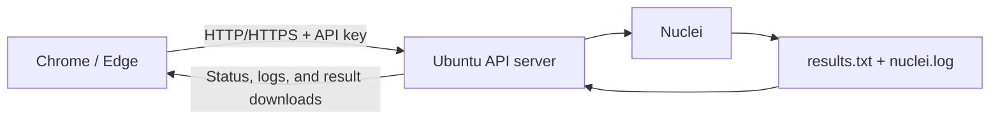

<div align="center">

# Nuclei Remote

**Run Nuclei on your own server, right from your browser.**


[Features](#features) · [Installation](#installation) · [Scan profiles](#scan-profiles) · [Service management](#running-with-systemd) · [API](#api) · [Troubleshooting](#troubleshooting)


</div>

---

## How it works

Choose a target URL, scan profile, and request rate. The extension sends a job to your server, which runs Nuclei and provides the status, log, and results file. The connection uses HTTP or HTTPS directly, without an SSH tunnel.



## Features

- **Scan the current tab** or enter a target URL manually.
- **Three scan profiles**: known CVEs, high/critical CVEs, and standard HTTP checks.
- **Configurable request rate** per second; `0` means unlimited.
- **Connection indicator** that distinguishes network and authentication errors.
- **Live Nuclei log preview** and remote scan cancellation.
- **Recent scan history** and downloadable `.txt` results.
- **API key authentication**, failed authentication limits, and HTTPS support.
- **systemd management script** for installation, startup, logs, and removal.

## Requirements

| Component | Requirements |
|---|---|
| Server | Ubuntu, Python 3.10+, and an installed Nuclei executable |
| Templates | Updated Nuclei templates available to the service user |
| Browser | Chrome or Microsoft Edge with Manifest V3 support |

Install Nuclei using the [official installation guide](https://docs.projectdiscovery.io/opensource/nuclei/install).

## Installation

### 1. Prepare the server

Copy the `server/` directory to Ubuntu, for example to `~/nuclei-remote/server`. Run the service as a regular user with access to Nuclei.

```bash
nuclei -version
nuclei -update-templates
command -v nuclei

sudo apt update
sudo apt install python3-venv

cd ~/nuclei-remote/server
python3 -m venv .venv
.venv/bin/python -m pip install -r requirements.txt

cp config.env.example config.env
chmod 600 config.env
```

Generate an API key:

```bash
python3 -c 'import secrets; print(secrets.token_hex(32))'
```

### 2. Configure the API

Open `server/config.env`, paste the generated key, and set the executable path returned by `command -v nuclei`:

```bash
NUCLEI_API_TOKEN='PASTE_GENERATED_TOKEN_AT_LEAST_32_CHARACTERS'
NUCLEI_BIN='/home/YOUR_USERNAME/go/bin/nuclei'

NUCLEI_API_HOST='0.0.0.0'
NUCLEI_API_PORT='8765'

NUCLEI_RESULTS_DIR='./results'
NUCLEI_LOG_DIR='./logs'

NUCLEI_TLS_CERT=''
NUCLEI_TLS_KEY=''
```

| Variable | Description |
|---|---|
| `NUCLEI_API_TOKEN` | API access key, at least 32 characters |
| `NUCLEI_BIN` | Full path to the Nuclei executable |
| `NUCLEI_API_HOST` | Bind address; `0.0.0.0` exposes the API on all IPv4 interfaces |
| `NUCLEI_API_PORT` | API port; defaults to `8765` |
| `NUCLEI_RESULTS_DIR` | Results directory; relative to `server/` when using `start.sh` |
| `NUCLEI_LOG_DIR` | Server log directory |
| `NUCLEI_TLS_CERT` / `NUCLEI_TLS_KEY` | Optional certificate and private key files for HTTPS |

Install and start the systemd service from the `server/` directory:

```bash
bash service.sh install
bash service.sh status
```

This enables automatic startup at boot. The helper requests `sudo` when needed. If you are logged in as root, specify a regular service account with `bash service.sh install --user YOUR_USERNAME`.

For a temporary foreground run instead:

```bash
bash start.sh
```


Allow the selected port through your server firewall and VPS provider's network rules. If you use UFW, you can restrict access to your own public IP:

```bash
sudo ufw allow from YOUR_PUBLIC_IP to any port 8765 proto tcp
```

> [!IMPORTANT]
> HTTP sends your API key and results without encryption. Configure [HTTPS](#https) for ongoing access over the internet. Keep `config.env`, TLS private keys, results, and logs out of your public repository.

### 3. Load the extension

1. Open `chrome://extensions` or `edge://extensions`.
2. Enable **Developer mode**.
3. Click **Load unpacked**.
4. Select the [`extension/`](extension/) directory containing `manifest.json`.
5. Pin **Nuclei Remote** to your browser toolbar.

Open **Server connection** in the extension and enter:

| Field | Example |
|---|---|
| Server API URL | `http://YOUR_SERVER_PUBLIC_IPV4:8765`, or your HTTPS URL |
| API key | The `NUCLEI_API_TOKEN` value from your server configuration |

Click **Save and test connection**, then grant the extension permission to access that host. The key is stored locally in your browser profile and is not synced through your account.

## Using the panel

1. Enter a URL or click **Use current tab URL**.
2. Choose a scan profile and request rate.
3. Click **Start scan**.
4. Watch the status or select **Show Nuclei log**.
5. Once the scan finishes, click **Download results .txt**.

Closing the popup does not stop a scan. Use **Stop** to terminate the server-side process. Reopening the popup retrieves the active scan and up to 20 recent jobs.

### Scan profiles

| Profile | Profile arguments | Coverage |
|---|---|---|
| **Known CVEs** | `-tags cve` | CVE templates across all severity levels |
| **CVEs: high and critical** | `-tags cve -severity high,critical` | CVE templates marked `high` or `critical` |
| **Standard HTTP checks** | Default templates restricted by `-pt http` | Broader checks, including CVEs, exposed files, panels, and misconfigurations |


### Request rate

| Value | Behavior |
|---|---|
| `5` | Default: up to 5 requests per second |
| `25` | Up to 25 requests per second |
| `0` | Unlimited Nuclei request rate: `-rl 0` |

The extension remembers your last value. Changes apply to new scans. With `0`, the `-c 2` concurrency setting still applies; API access limits remain separate.

### Connection status

| Indicator | Meaning |
|---|---|
| Gray | Connection not configured or not checked yet |
| Yellow | Checking the connection |
| Green | The API is responding and the key was accepted |
| Red | Network, authentication, or API response error |

The status is checked when the popup opens, after saving connection settings, and every **15 seconds** while the popup is open. Use **Check** to run a manual test. Invalid scan input does not indicate a lost connection.

## Results and logs

Each scan receives a unique ID and its own directory:

```text
server/
├── results/
│   └── SCAN_ID/
│       ├── results.txt    # findings saved with -o
│       ├── nuclei.log     # stdout/stderr, errors, and Nuclei statistics
│       └── job.json       # target, profile, rate limit, status, and timestamps
└── logs/
    ├── server.log         # structured JSON API events
    └── server.log.*       # rotated logs
```

**Popup log preview:** the latest 64 KiB of the Nuclei log, refreshed every 2.5 seconds together with the scan status. Nuclei writes statistics every 10 seconds.

**Server log:** requests, authentication failures, rejected requests, scan start and completion, process IDs, exit codes, and output progress. Rotation keeps a log file up to 5 MiB and three backups.

```bash
# Run from server/
tail -f logs/server.log
tail -f results/SCAN_ID/nuclei.log
```

Each request receives an `X-Request-ID` header. The popup includes that ID in error messages so you can find the matching server log entry. API logs omit the key, authorization headers, request bodies, and query parameters. Scan files may contain full URLs and target data.

## HTTPS

The API can serve HTTPS directly. Configure both files in `config.env`:

```bash
NUCLEI_TLS_CERT='/full/path/to/fullchain.pem'
NUCLEI_TLS_KEY='/full/path/to/privkey.pem'
```

The browser must trust the certificate, and the certificate must cover the hostname or IP used in the extension. The service user must be able to read both files.

Restart the service and set the extension URL to `https://YOUR_SERVER:8765`. Restart the service after certificate renewal as well.

You can also place an HTTPS reverse proxy in front of the API. Set `NUCLEI_API_HOST='127.0.0.1'` and forward requests to the local API port. The service does not trust `X-Forwarded-For`, so logs and rate limits will use the proxy's address in this configuration.

## API

Every endpoint requires:

```http
Authorization: Bearer YOUR_API_KEY
```

| Method | Endpoint | Description |
|---|---|---|
| `GET` | `/api/health` | Check availability and authentication |
| `GET` | `/api/jobs` | Retrieve up to 20 recent scans |
| `POST` | `/api/jobs` | Start a scan |
| `GET` | `/api/jobs/{id}` | Retrieve job status |
| `POST` | `/api/jobs/{id}/cancel` | Stop a scan; request body: `{}` |
| `GET` | `/api/jobs/{id}/output` | Download the text results |
| `GET` | `/api/jobs/{id}/log` | Read the latest 64 KiB of the Nuclei log |

### API limits

- The API key is compared in constant time and must contain at least 32 characters.
- After 10 failed authentication attempts from an IP, access is blocked until the current 60-second window ends.
- The general limit is 180 requests/minute/IP. A `429` response includes `Retry-After: 60`.
- Counters are stored in memory and reset on restart.
- Uvicorn limits concurrent connections/tasks to 32 and uses a 5-second keep-alive timeout.

Each instance uses one shared API key. Anyone holding it can access all scans on that instance. This release is intended for one trusted operator; it has no per-user ownership, permissions, or job queue.

## Running with systemd

After configuring `config.env` and installing the Python dependencies, use [`server/service.sh`](server/service.sh) to install and manage the service. Stop any manually started instance first to free the API port.

The script detects the application directory and generates the systemd unit with the correct paths. When run from a regular account, it requests `sudo` and uses that account as the service user. Installation enables startup at boot and starts or restarts the service.

```bash
# Run from server/
bash service.sh install
bash service.sh status
```

If you are logged in as root, specify a regular account that can read the configuration and write to the application directory:

```bash
sudo bash service.sh install --user ubuntu
```

The helper checks that the selected user can access the application and import its Python dependencies. It does not install Nuclei or Python dependencies, edit your configuration, or change firewall rules.

| Command | Action |
|---|---|
| `bash service.sh install` | Install/update the unit, enable startup at boot, and start/restart the service |
| `bash service.sh start` | Start the installed service |
| `bash service.sh stop` | Stop the service |
| `bash service.sh restart` | Restart after configuration changes |
| `bash service.sh status` | Show service status |
| `bash service.sh logs` | Follow the service journal; press Ctrl+C to exit |
| `bash service.sh uninstall` | Stop, disable, and remove the systemd unit |

To remove the service:

```bash
bash service.sh uninstall
```

Uninstall removes only `/etc/systemd/system/nuclei-remote.service` and its systemd startup registration. Your application files, virtual environment, `config.env`, scan results, and logs are preserved. Reinstall with `bash service.sh install` whenever needed.

**Stopping and uninstalling are different:** `stop` ends the current service process while keeping the unit and startup-at-boot setting. `uninstall` also disables automatic startup and removes the unit. Both actions stop any scan running under the service.

After editing `config.env`, apply the changes and check the service:

```bash
bash service.sh restart
bash service.sh status
bash service.sh logs
```

The helper requires Linux with a running systemd instance. It refuses to overwrite an unrelated unit or run the scanner as root. The earlier manual unit template remains available in [`server/nuclei-remote.service.example`](server/nuclei-remote.service.example). Run a single API instance, without multiple workers.

## Troubleshooting

| Problem | What to check |
|---|---|
| Disconnected | Public IPv4, port, firewall, VPS network rules, certificate, and extension host permission |
| `401` / authentication failed | Matching keys in the popup and `config.env`; restart the API after changing the key |
| `429` / API rate limit | Wait one minute and check `auth_failed` and `rate_limited` events |
| Nuclei error | Open the scan log in the popup or read its `nuclei.log` file |
| Missing templates | Run `nuclei -update-templates` as the service user |
| Scan interrupted after restart | Start the job again from the popup |
| Service installation fails | Create `.venv`, install dependencies, configure `config.env`, and check the selected account's access to the application directory |
| Service fails to start | Run `bash service.sh status` and `bash service.sh logs`; check the Nuclei path, configuration, and whether the API port is already in use |
| systemd is unavailable | Use `bash start.sh` for a foreground run; `service.sh` requires a host running systemd |

Check the listening port:

```bash
ss -ltnp | grep 8765
```

## Scope and limitations

- **One scan at a time**, with a 30-minute timeout. Additional start requests are rejected while a scan is running.
- The process is stopped when scan files exceed 25 MiB. Checks run every 0.5 seconds, so temporary overshoot is possible.
- Results remain on disk until manually removed.
- Targets must resolve to public IP addresses and use port 80 or 443.
- HTTP redirects and Interactsh tests are disabled. Code, headless, and fuzzing modes are not enabled.
- The extension does not forward browser sessions or cookies to the scanner.
- A single target URL does not automatically crawl every page.
- DNS validation is not network isolation; strict outbound restrictions require separate network controls.

> [!NOTE]
> Only scan targets you are authorized to test. Findings require verification, and an empty results file does not prove that a target is secure.

## Tests

From `server/`:

```bash
.venv/bin/python -m pip install -r requirements-dev.txt
.venv/bin/python -m unittest -v
```

Backend tests cover the API, authentication, failed authentication limits, key omission from logs, input validation, request rates, the `-o` argument, output writing with a Nuclei test double, cancellation, timeouts, and state recovery.

Popup logic has been tested with a Chrome API test double. A full test with real Nuclei and the loaded extension should be performed after configuration on the target server.

## Project structure

```text
nuclei-remote/
├── extension/                         # Chrome / Edge extension
│   ├── manifest.json
│   ├── popup.html
│   ├── popup.css
│   └── popup.js
├── server/                            # API and Nuclei process controller
│   ├── server.py
│   ├── start.sh
│   ├── service.sh
│   ├── config.env.example
│   ├── nuclei-remote.service.example
│   ├── requirements.txt
│   └── requirements-dev.txt
└── README.md
```

## Documentation

- [Nuclei installation](https://docs.projectdiscovery.io/opensource/nuclei/install)
- [Running Nuclei and using templates](https://docs.projectdiscovery.io/opensource/nuclei/running)
- [Nuclei repository](https://github.com/projectdiscovery/nuclei)
- [Chrome extension permissions](https://developer.chrome.com/docs/extensions/reference/api/permissions)

Nuclei Remote is an independent project using Nuclei by ProjectDiscovery.
